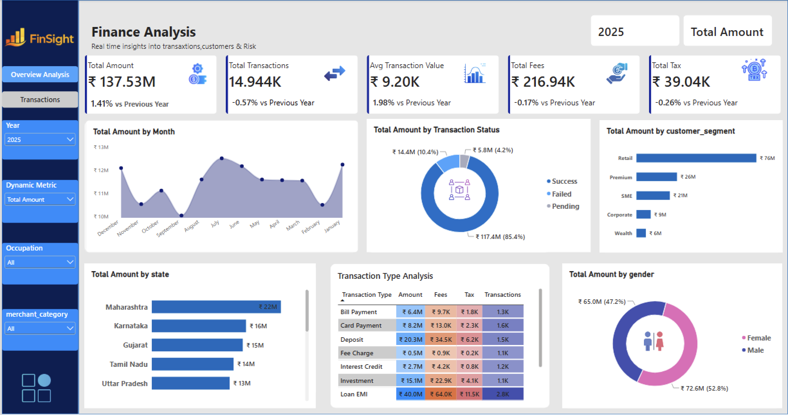

# Finance Project - Power BI Dashboard
Analysis of 50,000 banking transactions and 5,000 customers.

## Files
- data/customers.csv - customer details
- data/finance_transactions.csv - transactions with fraud flag and risk score
- dashboard/Finance_project.pbix - Power BI report

## Dashboard Preview

### Overview Analysis

### Transactions

## Dashboard Preview

### Overview Analysis

### Transactions

